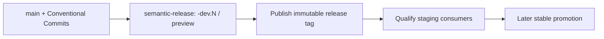

# Medrunner API Client

This TypeScript library acts as an official client for the Medrunner API.

Learn more at [medrunner.dev](https://medrunner.dev)!

## Changelog

See [CHANGELOG.md](CHANGELOG.md) for release notes and breaking changes.

## Getting Started

```ts
import { MedrunnerApiClient } from "@medrunner/api-client";

const apiConfig = {
  baseUrl: "https://api.medrunner.space",
  refreshToken: "YOUR_API_TOKEN",
};

const api = MedrunnerApiClient.buildClient(apiConfig);
const self = await api.client.get();

console.log(self);
```

## Error responses

API calls resolve to `ApiResponse` when the server returns an HTTP error.
When the response body follows the API's Problem Details schema, it is exposed as `problemDetails`.

```ts
const response = await api.client.get();

if (!response.success) {
  console.error(response.problemDetails?.title ?? response.errorMessage);
}
```

`ProblemDetails` is also exported for consumers that need to type their own error-handling helpers.

## OIDC client credentials

Use `OidcClientCredentialsTokenProvider` when a service obtains bearer tokens through the OAuth 2.0 client-credentials grant.
The provider caches tokens and supports a deliberately scoped `openidClient` boundary for discovery and token-grant interoperability.

```ts
import { OidcClientCredentialsTokenProvider } from "@medrunner/api-client";

const accessTokenProvider = new OidcClientCredentialsTokenProvider({
  issuer: new URL("https://identity.example.test/application/o/medrunner/"),
  clientId: "service-client",
  clientSecret: process.env.OIDC_CLIENT_SECRET,
  scopes: ["client:read"],
  openidClient: {
    discoveryAlgorithm: "oidc",
    timeoutSeconds: 10,
    additionalTokenParameters: {
      resource: "https://api.example.test",
    },
  },
});
```

`openidClient.allowInsecureRequests` permits HTTP for both discovery and token requests.
Use it only for local development or tests because it disables the normal HTTPS-only protection.

`customFetch`, `useMtlsEndpointAliases`, and `clientAuthentication` support advanced proxy, mutual-TLS, and non-Basic client-authentication deployments.
When supplying `clientAuthentication`, `clientSecret` is optional.

Additional token parameters may contain standard settings such as `resource` and provider extensions such as `audience`.
The provider rejects `scope`, `grant_type`, and client-authentication parameters because it owns those values.

### Authentik global issuer mode

Authentik normally derives a provider-specific issuer, which the default OIDC discovery convention handles automatically.
In global issuer mode, its issuer is the instance root while its discovery document remains provider-specific.
Configure both values explicitly in that case.

```ts
const accessTokenProvider = new OidcClientCredentialsTokenProvider({
  issuer: new URL("https://auth.example.test/"),
  clientId: "bot-med",
  clientSecret: process.env.OIDC_CLIENT_SECRET,
  scopes: ["client:read"],
  openidClient: {
    discoveryDocumentUrl: new URL("https://auth.example.test/application/o/bot-med/.well-known/openid-configuration"),
  },
});
```

The provider verifies that the discovery document advertises the configured issuer before requesting a token.
Do not combine `discoveryDocumentUrl` with `discoveryAlgorithm` because an explicit document URL does not require derivation.

## Creating a new package version



The repository's `release.config.mjs` owns version and channel selection.
A qualifying commit on `main` creates a `-dev.N` prerelease on `preview`; the shared publication workflow builds from the immutable release tag and uses its version/channel outputs.
Use `release/rc` for release candidates and `release/stable` for a separately approved stable promotion.
For coordinated error diagnostics, publish upstream prereleases first, regenerate downstream lockfiles from real registry metadata, and qualify staging before considering production.
See [the diagnostics release notes](docs/error-diagnostics.md) for the compatible dev candidate set.
