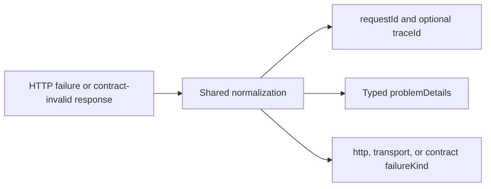

# Error diagnostics



Failed `ApiResponse` results retain their existing status and string `errorMessage`, with additive typed diagnostic fields.
Read `requestId` directly and `problemDetails.errorCode`, `errors`, or typed recruitment `data` for domain handling; do not parse serialized error text.

```ts
const response = await api.staff.get();
if (!response.success) {
  console.error(response.statusCode, response.requestId, response.problemDetails?.title);
}
```

The response header `X-Request-ID` takes precedence over a conflicting body identifier, with `requestIdMismatch` recorded in structured failures.
Malformed/empty bodies still retain a usable response header; legacy responses without an ID leave it absent, and network failures never invent a server ID.

`ApiFailureError` carries sanitized typed context from token acquisition and response-contract validation.
The original authentication replay limit remains one; the exposed ID belongs to the terminal replay or failed token exchange, and an invalid HTTP 200 response retains its actual status and request ID with `failureKind: "contract"`.

Structured failure loggers receive available request/trace IDs without raw request/transport objects.
Identifiers remain outside metric dimensions; a request/trace ID is not a guarantee that remote tracing was enabled.

The staff client inherits this normalization and the same generated API-owned error contract.
Both updated clients tolerate legacy Problem Details and legacy numeric domain-code responses during the coordinated rollout.

The initial coordinated rollout uses the `preview` channel with `-dev.N` versions and staging consumers.
Exact versions are calculated from current tags/commits and confirmed by semantic-release CI before downstream lockfiles are generated.
